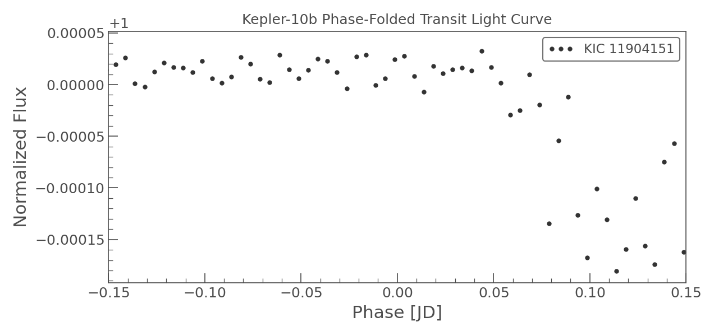

# kepler10b-exoplanet-inceptiontime

# Automated Exoplanet Transit Detection on NASA Kepler Telemetry Using InceptionTime

**Author:** Taha Tahir  
**Target System:** Kepler-10 (KIC 11904151 / Kepler-10b)  
**Tech Stack:** Python 3, PyTorch, `tsai` (`InceptionTime`), `Lightkurve`, Google Colab

## Overview

This project builds an end-to-end astrophysics signal-processing and 1D deep-learning pipeline to extract, phase-fold, and classify transiting exoplanet signatures from space-telescope photometry. Rather than coding neural network layers from scratch, it imports the pre-built **`InceptionTime`** time-series architecture from `tsai` and evaluates it on real NASA telemetry of **Kepler-10b** (the first confirmed rocky exoplanet discovered by NASA's Kepler mission).

## Pipeline & Methodology

1. **Multi-Quarter Telemetry Acquisition & Detrending (`Lightkurve`)**
   - Queried the STScI MAST archive for **Kepler-10** long-cadence photometry and stitched 5 quarters of observations (`search_result[:5].download_all()`).
   - Removed NaN artifacts, filtered $>5\sigma$ outliers, normalized flux, and applied Savitzky-Golay detrending (`window_length=401`) to remove low-frequency stellar activity.
   - Phase-folded the flattened light curve around Kepler-10b's orbital period (`0.8377 days`) to isolate the transit dip.

2. **Signal Formatting & Standardization**
   - Extracted the transit window across orbital phase `-0.15` to `+0.15` and resampled onto a uniform **200-point** grid.
   - Applied z-score normalization (`(x - mean) / std`) so inference relies on transit morphology rather than raw flux scale.

3. **1D Deep Learning Classification (`InceptionTime`)**
   - Imported `InceptionTime(c_in=1, c_out=2)` directly from `tsai.models.InceptionTime` to maintain clean compatibility in modern Python 3.13 environments.
   - Trained the network on **1,000** labeled curves (U-shaped transit dips vs. Gaussian baseline noise) using `Adam` (`lr=1e-3`) and `CrossEntropyLoss` over **8 epochs** (`batch_size=64`).
   - Evaluated the trained model on the unseen, real **Kepler-10b** phase-folded curve.

## Results & Scientific Framing

- **Kepler-10b Exoplanet Probability:** **99.75%** on stitched NASA Kepler photometry.
- **Scope & Limitations:** This work demonstrates an independent re-detection and morphological classification of a known exoplanet (**Kepler-10b**) from real telescope telemetry. Full production catalog-vetting systems (such as NASA's [ExoMiner](https://github.com/nasa/ExoMiner)) incorporate additional multi-modal diagnostics—including centroid shifts, odd/even transit depth comparisons, and secondary eclipse checks—to rule out astrophysical false positives like eclipsing binaries.

## Repository Contents

- `kepler10b_inceptiontime_pipeline.ipynb` — Complete reproducible Google Colab notebook with cell outputs.
- `kepler10b_transit.png` — Binned phase-folded transit light curve generated from stitched Kepler-10 quarters.
- `README.md` — Project overview, methodology, and results.
